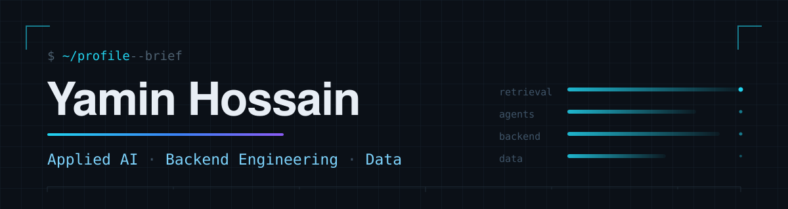
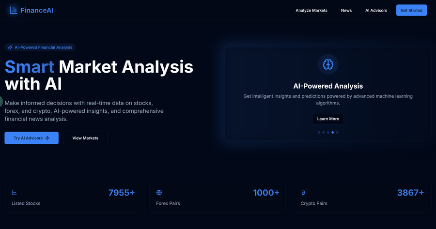
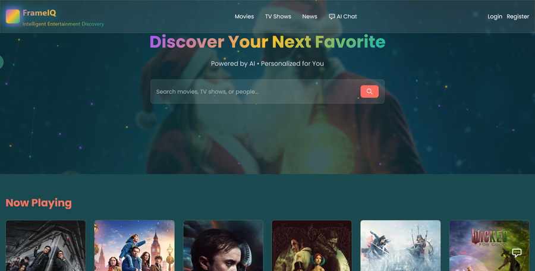
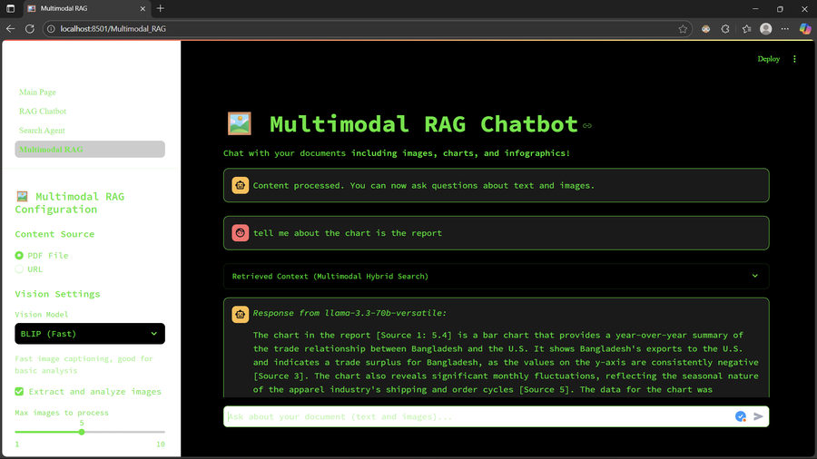
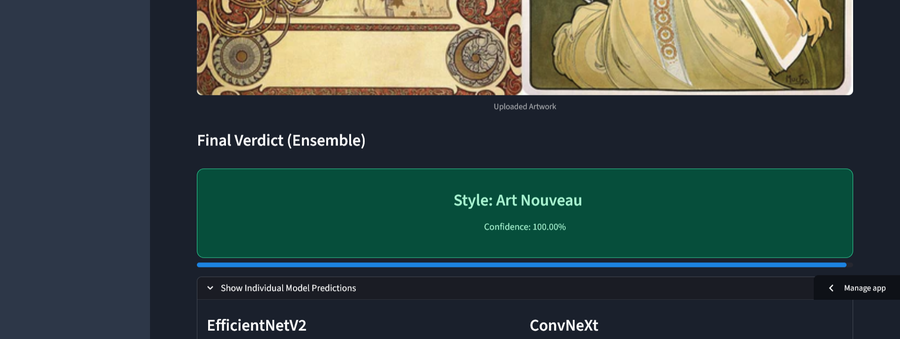
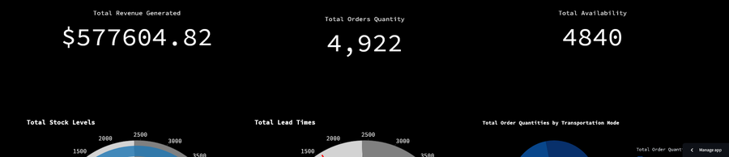
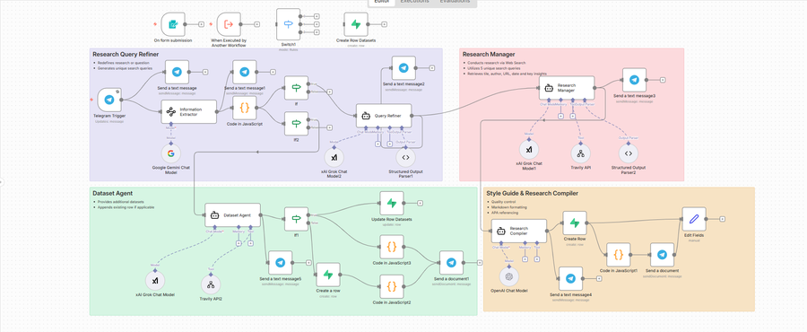

 
 
I build AI-enabled applications and data tools — retrieval systems, multi-agent pipelines, and the backend around them. My attention sits where the model meets the system: where context comes from, how a service degrades, and whether someone else can read it and run it.
 
 

---

## ◆ Selected Work

### ▸ AI applications and agent systems

#### [Ai-Finance](https://github.com/RobinMillford/Ai-Finance)

Market analysis for stocks, forex, and crypto, run through a parallel agent pipeline. One low-temperature supervisor call returns a plan; LangGraph then fans the chosen specialists out simultaneously, so a three-agent read costs the same three model hops as a single-agent one. *Generated analysis, not investment advice.*

    

**[Source](https://github.com/RobinMillford/Ai-Finance)** · **[Live app](https://financeai-ai.duckdns.org/)**

 

#### [FrameIQ](https://github.com/RobinMillford/FrameIQ)

A film and television library — watchlist, diary, episode tracking, social feed — built around CineBot, an assistant that routes requests without spending an LLM call, so ordinary questions cost no extra inference. Conversation state is checkpointed to SQLite in WAL mode, which keeps memory intact across restarts and redeploys.

   

**[Source](https://github.com/RobinMillford/FrameIQ)** · **[Live app](https://frameiq.studio/)**

 

### ▸ Retrieval and applied deep learning

#### [Cortex AI — Multi-Model Insights Hub](https://github.com/RobinMillford/Cortex-AI-Multi-Model-Insights-Hub)

Retrieval over documents, figures, and video transcripts, grounded with BM25 keyword scoring running beside sentence-transformer embeddings rather than trusting vectors alone. Figures pass through a vision model first, and it is that description — not the raw image — that gets embedded and searched. Answers carry source references.

   

**[Source](https://github.com/RobinMillford/Cortex-AI-Multi-Model-Insights-Hub)**

 

#### [GopherNotebook](https://github.com/RobinMillford/GopherNotebook)

A local-first document workspace with a Go/Gin backend. Weaviate runs hybrid BM25-and-vector retrieval, a Qwen3 cross-encoder reranks the top candidates, and answers cite a file and page. Ingestion and reranking stay on your own machine; generation can go local or to any cloud provider.

    

**[Source](https://github.com/RobinMillford/GopherNotebook)**

 

#### [Art Intelligence Hub](https://github.com/RobinMillford/Art-Intelligence-Hub)

Two vision problems kept deliberately apart: is this artwork AI-made or human-made, and which style is it? Authenticity runs a fine-tuned MobileNetV2 with Grad-CAM heatmaps marking the regions behind the call, while style is soft-voted across EfficientNetV2-B2 and ConvNeXt-Small, with each model's confidence shown separately rather than hidden behind the ensemble.

   

**[Source](https://github.com/RobinMillford/Art-Intelligence-Hub)** · **[Training notebook](https://www.kaggle.com/code/yaminh/ai-vs-real-project)**

 

### ▸ Data analytics and workflow automation

#### [Analytics for Fashion Supply Management](https://github.com/RobinMillford/Analytics_for_Fashion_Supply_Management)

Ten linked views over a single fashion supply-chain file, built to make trade-offs legible rather than to fill a dashboard. The one worth opening first is price against manufacturing cost per product type, which turns a revenue total into an actual margin — the gap between what a garment sells for and what it cost to make.

   

**[Source](https://github.com/RobinMillford/Analytics_for_Fashion_Supply_Management)**

 

#### [My n8n Workflows](https://github.com/RobinMillford/My_n8n_workflows)

A 42-node research agent that lives inside Telegram. A Switch fans each query into parallel web-research and dataset-hunting branches, three different models handle refinement, long-context extraction, and synthesis respectively, and results are logged to Supabase before coming back out as a file. It imports as JSON; the credentials are yours to supply.

   

**[Source](https://github.com/RobinMillford/My_n8n_workflows)**

 

---

## ◆ GitHub Activity

<b>Public GitHub Activity</b>
 
 

 
 
<b>Recent Commits</b>
 
 

 
Public GitHub activity; counts reflect GitHub's available statistics and may be cached.

---

## ◆ Toolkit

Drawn from what the projects above actually run on.

**AI & retrieval**
     

**Languages & backend**
    

**Data & visualization**
   

**Automation & infrastructure**
  

---

## ◆ Research & Publications

Peer-reviewed work, mostly on computer vision.

- **ICDMIS 2024** — [Machine Learning for Computer Vision: A Comprehensive Overview](https://link.springer.com/chapter/10.1007/978-981-96-6053-7_7)
- **ICMIB 2024** — [Improving Sports Categorization in WiFi-Blocked Areas: Modifying YOLO Network for All-Inclusive Sports Image Identification](https://link.springer.com/chapter/10.1007/978-981-96-3797-3_19)
- **ICICCT 2024** — [YOLOv8 Image Processing for Evaluation of Stability Algorithms Based on Neural Networks: A Sports Use Case](https://link.springer.com/chapter/10.1007/978-981-97-7710-5_46)

---

  

---

The longer write-up of this work, plus background and the rest of the repository archive, is at **[yaminhossain.fun](https://www.yaminhossain.fun/)**. For implementation detail the source is the better reference — [issan.yamin@gmail.com](mailto:issan.yamin@gmail.com) if either is not enough.